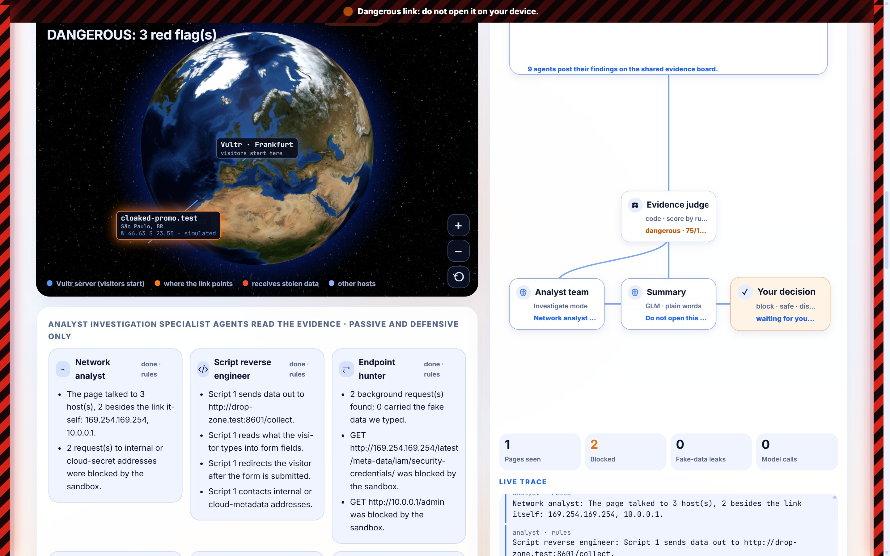
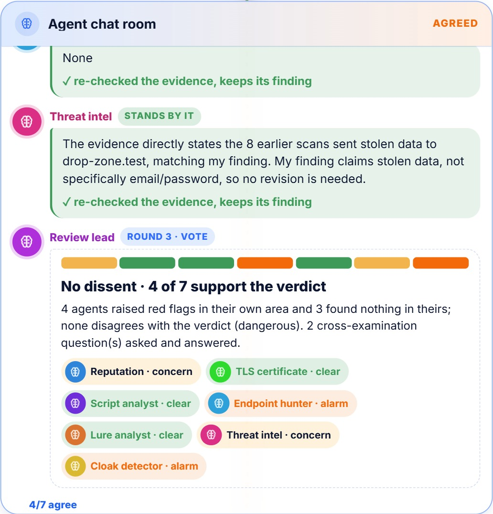
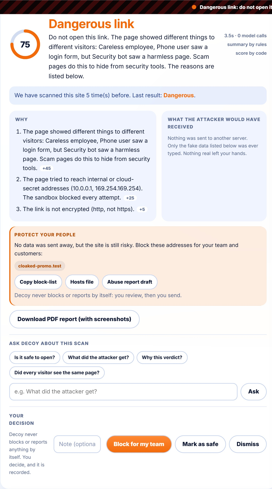
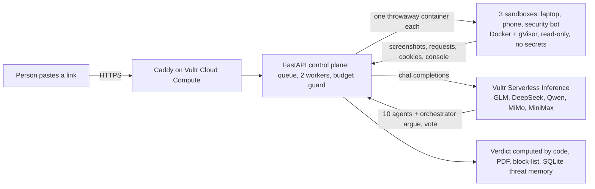

<p align="center"></p>

<h1 align="center">Decoy</h1>

**Open a suspicious link without risking your machine.** Paste a link; three AI visitors open it in **sealed, throwaway browsers on Vultr**, type **fake** passwords and card numbers, and watch where the data goes. **Ten AI agents on five open models** read the evidence and argue it out in a chat room chaired by an orchestrator until they vote. You get a plain verdict with proof, the country the stolen data would reach, a block-list and a PDF report. Then every sandbox is destroyed.

> **Live demo: https://45-32-155-174.sslip.io** (Vultr server, HTTPS, rate limited, daily budget cap). Test links are our own fake sites.

## Why this matters
Links in messages are how many scams start, for people and for companies. All figures are **reported cases in the United States**, so the real numbers are higher.
- **People:** in 2025 the FTC received **3 million fraud reports** and consumers reported **$15.9 billion** lost (2024: 2.6 million reports, over $12 billion). Source: [FTC press release, March 2026](https://www.ftc.gov/news-events/news/press-releases/2026/03/ftc-testifies-joint-economic-committee-agencys-efforts-combat-fraud); yearly losses first reported 2021 to 2025: $5.8B, $8.8B, $10B+, $12.5B, $15.9B ([FTC press releases](https://www.ftc.gov/news-events/news/press-releases)). The FBI logged **191,561 phishing and spoofing complaints** in 2025 ([FBI IC3 2025 Internet Crime Report](https://www.ic3.gov/AnnualReport/Reports/2025_IC3Report.pdf)).
- **Companies:** business email compromise, the scam aimed at companies, produced **24,768 complaints and $3.05 billion in reported losses** in 2025 (same FBI report; 2024: $2.77 billion, 2023: $2.95 billion). IBM's 2025 report puts the average cost of one data breach at **$4.44 million worldwide and $10.22 million in the United States** ([IBM press release, July 2025](https://newsroom.ibm.com/2025-07-30-ibm-report-13-of-organizations-reported-breaches-of-ai-models-or-applications,-97-of-which-reported-lacking-proper-ai-access-controls)).

<p align="center"></p>

## What you get
- **Instant address read** (under a second): a transparent checklist of about 25 clues scores the link itself and gives three plain reasons, before any sandbox opens. A hint, never the verdict.
- **Sealed browsers** (Docker + gVisor, read-only, no root, no secrets, private networks blocked twice). The first picture appears in 2 to 4 seconds because clean sandboxes are kept warm; each is used once, then destroyed.
- **Three visitors** (laptop, phone, security bot) compare what they saw: a login form shown to people but a harmless page to the bot is cloaking. Bot checks are reported, never solved.
- **Agent swarm, every agent an AI model:** ten agents (DeepSeek, Qwen, MiMo, MiniMax and GLM through Vultr) read the facts code counted for their area and write what they mean. They post findings, **ask each other pointed questions**, and the orchestrator (`glm-5.3`) joins in, asks the agents directly, proposes a statement and calls the vote. Every agent votes with its own model; objections trigger another round. Code never writes a question or a reply: it only validates, counts the votes and owns the score. Click any agent to read its model and system prompt.
- **Where the data goes:** endpoint and country on a globe, a block-list (`.txt`, hosts file, JSON) and an abuse-report draft. Decoy never blocks or reports by itself.
- **Inspector and AI summary:** every request, cookie, script and console line, plus a plain-words summary (facts counted by code).
- **Normal or Advanced investigation:** Advanced adds the analyst team's incident report (indicators, suggested ATT&CK mapping). Every scan downloads as a **PDF with screenshots**.

<p align="center"> &nbsp; </p>

## How Decoy runs on Vultr

- **Vultr Cloud Compute (Frankfurt, 2 vCPU / 4 GB):** the control plane (FastAPI, job queue, rate limits, budget guard), Caddy for automatic HTTPS, and the host of every sandbox. One server runs the whole product.
- **Vultr Serverless Inference:** every agent is a model call: ten specialist agents on different open models plus the orchestrator (`glm-5.3`), so the agents genuinely disagree and cross-examine each other.
- **Vultr Firewall Groups + host rules:** only ports 22, 80 and 443 are open; container traffic toward private and cloud-metadata ranges is dropped.
- **Vultr API:** creates and monitors the server, the firewall group and the inference subscription, and checks the cost.

**The agent's use case, and how it executes real tasks.** A person (or a security team) pastes a link they do not trust. Decoy really opens it: three sandboxed browsers load the live page, click through it like a person, type **fake** credentials and card numbers into the real forms, and record every request, redirect, download and cookie. The agents read that evidence; code computes the verdict; the person decides. Real task, real page, nothing run on the person's machine.

## Containment (Blast Radius Zero)
- **Process isolation:** every visitor runs in its own Docker container under gVisor (`runsc`), read-only root, no root user (uid 10001), all capabilities dropped, `no-new-privileges`. Page code never runs on the host or inside the app.
- **Secret hygiene:** the sandbox starts with an empty environment; the inference key lives only on the control plane and never enters a container.
- **Resource limits:** memory, CPU and process-count caps and a size-limited `/tmp` on every container; per-scan caps on model calls and seconds, a daily budget, a kill switch and a limit on parallel scans.
- **Network:** private and cloud-metadata addresses are blocked twice, inside the browser runner and by host firewall rules; the Vultr firewall allows 22, 80 and 443 only.
- **Lifecycle:** each sandbox is used once and destroyed; the UI shows "sandbox destroyed".
- **See it yourself:** scan the demo link `http://n0rthbank-login.test:8601/`. The page tries to read the cloud metadata service (`169.254.169.254`); the **Blocked by the sandbox** card lists every attempt it made and could not complete.

## Honest by design
- **Needs a human look:** when the evidence conflicts (a bot check hid the page, or the address looks risky while the visit looked clean) Decoy says so instead of guessing.
- **Your decisions count:** *Block* and *Mark as safe* become real block and allow lists that win over the score, and the verdict says so.
- **Base rate:** most links are harmless, so every flag reminds you to read the reasons and screenshots first.
- **General judgment guide:** every agent is told what is normal on legitimate sites (trackers, newsletter forms, "sign in with ...", young domains) and what real warning signs look like, so big honest sites are not accused.

## Measured, not only claimed
The design follows published research: scam kits hide from scanners with user-agent, location and script checks (*PhishFarm*, IEEE S&P 2019), so three different visitors open every link; address features are long-studied signals (Marchal et al., ICDCS 2016, and the URL-feature literature); our addition is **behaviour in a sealed browser**.

**Measured** (`tools/benchmark.py`, reproducible; labelled phishing links from the OpenPhish community feed vs well-known sites; a "needs a look" verdict counts as right because it sends the link to a person). Four batches in a row before the last fixes (104 assessable links): 85.6% right, 0 of 50 well-known sites wrongly flagged as unsafe, 39 of 54 phishing links flagged. We read every miss: the agents often wrote "this page imitates a brand it does not own" but the score ignored it. The fix (a model proposes the claim, code verifies it before it adds weight) and a few score rules were then tested on a **fresh batch of 40 links**: 37 of 40 right (92.5%, 95% interval about 80% to 97%), 17 of 20 phishing links flagged, **0 of 20 well-known brand sites wrongly flagged**. **How to read the 7.5%:** it is not a margin of error. It is the share of that batch that Decoy got wrong (3 of 40 links, each listed and studied). It is also not a plain yes/no score: when Decoy is unsure it says **"needs a human look"** instead of guessing, and that answer sends the link to a person, so it carries little risk. The statistical margin of error is the 95% interval above (about 80% to 97%), which is wide because the sample is small. A clean result still means only that nothing harmful was seen during the visit. Progression so far: 85.6% (four batches), then 85% (before fixes), then **92.5%** (fresh batch after fixes); newer fresh batches are running and will be added here when they finish. Small sample, phishing pages that were already taken down are reported separately, and the fixes were designed from the earlier batches, so treat it as a first result, not a certification.

## Run it
```bash
pip install -r requirements.txt
python -m playwright install chromium
docker build -t decoy-sandbox:latest sandbox/
python -m uvicorn demo_sites.server:app --port 8601   # our fake sites
python -m uvicorn server:app --port 8020              # Decoy
```
Open http://localhost:8020. Add a Vultr Serverless Inference key to `.env` for the AI agents (without a key only the plain checks run). `DECOY_SANDBOX=local` skips Docker for development only and is **not isolated**. Deploy: Ubuntu 24.04 (2 vCPU / 4 GB), `deploy/setup.sh`, `deploy/gvisor.sh`.

**Built on Vultr:** Cloud Compute (control plane, queue, sandbox host), Serverless Inference (all agents), Firewall Groups (22, 80, 443 only), API (server, firewall, AI subscription).

## Limits
A clean result means nothing harmful was seen **during this visit**; it is not a guarantee. Chromium only, no attachment scanning, CAPTCHAs are not solved, the benchmark is small (read the intervals), and technique labels are suggestions for an analyst to confirm. A person decides.

Tests: `python -m pytest tests -q` · MIT license.
