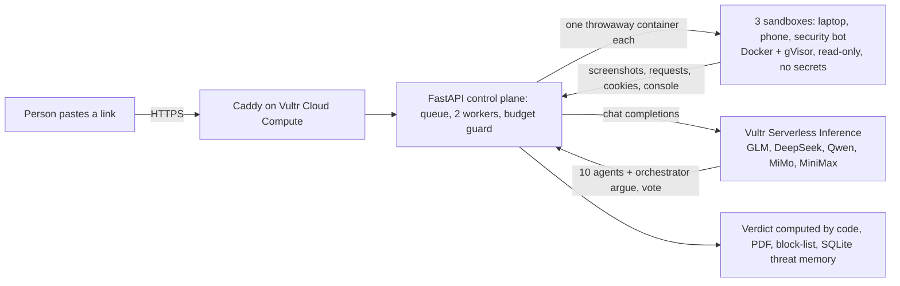
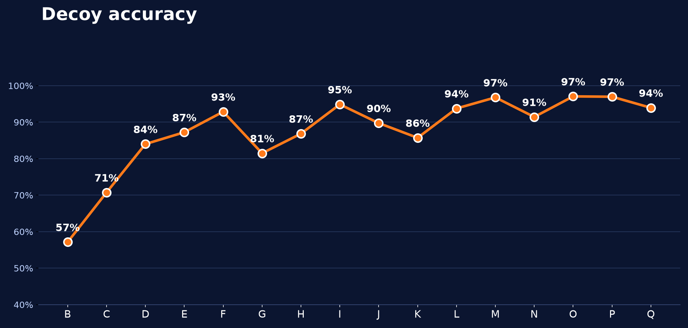

<p align="center"></p>

<h1 align="center">Decoy</h1>

**Open a suspicious link without risking your machine.** Paste a link and Decoy sends **a team of AI agents** to open it for you, inside **sealed, throwaway browsers on Vultr**. Three AI visitors (a laptop, a phone and a security bot) click through the page and type **fake** passwords and card numbers while Decoy records where the data goes. Then **ten AI agents on five different open models**, served by **Vultr Serverless Inference**, read the evidence, cross-examine each other and vote, chaired by an orchestrator. You get one plain verdict with proof, the country the stolen data would reach, a block-list and a PDF report. Then every sandbox is destroyed. Nothing ever touches your computer or your phone.

> **Try it live: https://45-32-155-174.sslip.io** (Vultr server, HTTPS, rate limited, daily budget cap). Paste any link, or use one of our own fake test sites.

### How it works in 60 seconds
1. **You paste a link** (from an email, WhatsApp, SMS or a QR picture).
2. **Three AI visitors open it on Vultr**, each in its own sealed sandbox, and behave like real people: they click, scroll and type fake data.
3. **Ten AI agents read the evidence**, each from its own angle (address, certificate, page behaviour, hidden scripts, where the data goes, the lure text, brand claims...). They post findings and **ask each other questions**.
4. **An orchestrator cross-examines them and calls a vote.** The models argue; **code owns the score**, so the result is always counted, never invented.
5. **You get the verdict in plain words, with proof**, and you make the final decision.

### Why this is different
Link scanners check lists of links that are already known to be bad, so a brand-new scam is invisible to them. Decoy **opens the link and watches what it really does**, using a whole team of AI agents instead of one model: ten different open models disagree, challenge each other and only then agree, which is how a hidden trick gets noticed. **Vultr is the whole platform**: the server and every sandbox run on Vultr Cloud Compute behind a Vultr firewall, and every one of the agents is a Vultr Serverless Inference call.

## Why this matters
Links in messages are how many scams start, for people and for companies. All figures are **reported cases in the United States**, so the real numbers are higher.
- **People:** in 2025 the FTC received **3 million fraud reports** and consumers reported **$15.9 billion** lost (2024: 2.6 million reports, over $12 billion). Source: [FTC press release, March 2026](https://www.ftc.gov/news-events/news/press-releases/2026/03/ftc-testifies-joint-economic-committee-agencys-efforts-combat-fraud); yearly losses first reported 2021 to 2025: $5.8B, $8.8B, $10B+, $12.5B, $15.9B ([FTC press releases](https://www.ftc.gov/news-events/news/press-releases)). The FBI logged **191,561 phishing and spoofing complaints** in 2025 ([FBI IC3 2025 Internet Crime Report](https://www.ic3.gov/AnnualReport/Reports/2025_IC3Report.pdf)).
- **Companies:** business email compromise, the scam aimed at companies, produced **24,768 complaints and $3.05 billion in reported losses** in 2025 (same FBI report; 2024: $2.77 billion, 2023: $2.95 billion). IBM's 2025 report puts the average cost of one data breach at **$4.44 million worldwide and $10.22 million in the United States** ([IBM press release, July 2025](https://newsroom.ibm.com/2025-07-30-ibm-report-13-of-organizations-reported-breaches-of-ai-models-or-applications,-97-of-which-reported-lacking-proper-ai-access-controls)).

<p align="center"></p>

## What you get
- **Instant address read** (under a second): a transparent checklist of about 25 clues scores the link itself and gives three plain reasons, before any sandbox opens. A hint, never the verdict.
- **Sealed browsers** (Docker + gVisor, read-only, no root, no secrets, private networks blocked twice). The first picture appears in 2 to 4 seconds because clean sandboxes are kept warm; each is used once, then destroyed.
- **Three visitors** (laptop, phone, security bot) compare what they saw: a login form shown to people but a harmless page to the bot is cloaking. Bot checks are reported, never solved.
- **A team of ten AI agents, every one a real model call on Vultr Serverless Inference:** five open model families (DeepSeek, Qwen, MiMo, MiniMax and GLM) read the facts code counted for their area and write what they mean. They post findings, **ask each other pointed questions**, and the orchestrator (`glm-5.3`) joins in, asks the agents directly, proposes a statement and calls the vote. Every agent votes with its own model; objections trigger another round. Code never writes a question or a reply: it only validates, counts the votes and owns the score. Click any agent to read its model and system prompt.
- **Where the data goes:** endpoint and country on a globe, a block-list (`.txt`, hosts file, JSON) and an abuse-report draft. Decoy never blocks or reports by itself.
- **Inspector and AI summary:** every request, cookie, script and console line, plus a plain-words summary (facts counted by code).
- **Normal or Advanced investigation:** Advanced adds the analyst team's incident report (indicators, suggested ATT&CK mapping). Every scan downloads as a **PDF with screenshots**.

<p align="center"> &nbsp; </p>

## How Decoy runs on Vultr

- **Vultr Cloud Compute (Frankfurt, 2 vCPU / 4 GB):** the control plane (FastAPI, job queue, rate limits, budget guard), Caddy for automatic HTTPS, and the host of every sandbox. One server runs the whole product.
- **Vultr Serverless Inference:** every agent is a model call: ten specialist agents on different open models plus the orchestrator (`glm-5.3`), so the agents genuinely disagree and cross-examine each other.
- **Vultr Firewall Groups + host rules:** only ports 22, 80 and 443 are open; container traffic toward private and cloud-metadata ranges is dropped.
- **Vultr API:** creates and monitors the server, the firewall group and the inference subscription, and checks the cost.

**The agent's use case, and how it executes real tasks.** A person (or a security team) pastes a link they do not trust. Decoy really opens it: three sandboxed browsers load the live page, click through it like a person, type **fake** credentials and card numbers into the real forms, and record every request, redirect, download and cookie. The agents read that evidence; code computes the verdict; the person decides. Real task, real page, nothing run on the person's machine.

## Containment (Blast Radius Zero)
- **Process isolation:** every visitor runs in its own Docker container under gVisor (`runsc`), read-only root, no root user (uid 10001), all capabilities dropped, `no-new-privileges`. Page code never runs on the host or inside the app.
- **Secret hygiene:** the sandbox starts with an empty environment; the inference key lives only on the control plane and never enters a container.
- **Resource limits:** memory, CPU and process-count caps and a size-limited `/tmp` on every container; per-scan caps on model calls and seconds, a daily budget, a kill switch and a limit on parallel scans.
- **Network:** private and cloud-metadata addresses are blocked twice, inside the browser runner and by host firewall rules; the Vultr firewall allows 22, 80 and 443 only.
- **Lifecycle:** each sandbox is used once and destroyed; the UI shows "sandbox destroyed".
- **See it yourself:** scan the demo link `http://n0rthbank-login.test:8601/`. The page tries to read the cloud metadata service (`169.254.169.254`); the **Blocked by the sandbox** card lists every attempt it made and could not complete.

## Honest by design
- **Needs a human look:** when the evidence conflicts (a bot check hid the page, or the address looks risky while the visit looked clean) Decoy says so instead of guessing.
- **Your decisions count:** *Block* and *Mark as safe* become real block and allow lists that win over the score, and the verdict says so.
- **Base rate:** most links are harmless, so every flag reminds you to read the reasons and screenshots first.
- **General judgment guide:** every agent is told what is normal on legitimate sites (trackers, newsletter forms, "sign in with ...", young domains) and what real warning signs look like, so big honest sites are not accused.

## Measured, not only claimed
The design follows published research: scam kits hide from scanners with user-agent, location and script checks (*PhishFarm*, IEEE S&P 2019), so three different visitors open every link; address features are long-studied signals (Marchal et al., ICDCS 2016, and the URL-feature literature); our addition is **behaviour in a sealed browser**.

**Measured** (`tools/benchmark.py`, reproducible): labelled phishing links from the OpenPhish community feed against well-known sites and trusted organizations (governments, universities, nonprofits, banks, big tech), scanned live on the deployed app. **More than 300 links scanned live, November 4 to 8.** A scan counts as right when a phishing link is flagged (Suspicious, Dangerous or "needs a human look") or a safe site is not called Suspicious or Dangerous. Pages Decoy could not assess (errors, bot checks, pages already taken down) are left out and shown in the denominators.

<p align="center"></p>

- **How it got there:** the early batches (B to H) were tuning rounds: we read every miss and fixed its cause (a model-proposed brand claim that code verifies, a password asked on a risky host, free-hosting names, young domains with a fresh certificate, empty pages). Batches I to Q were run on fresh links after the fixes.
- **Last six batches (L to Q): 188 of 198 assessable links right = 94.9%, median batch 95%.** 86 of 96 phishing links flagged. **0 of 102 safe sites called Suspicious or Dangerous**; a few big sites that showed a bot check were answered "needs a human look" instead.
- **The gap to 100% is not purely error.** In many cases Decoy does not guess: it says **"needs a human look"** and hands the link to a person, who is warned and decides. The real misses are listed in our notes: pages with nothing to read, and brand-new domains with a sign-in form.
- **Small samples:** each batch is 30 to 40 links, so read the intervals as wide (about 80% to 97% for a single batch). The fixes were designed from earlier batches. A clean result still means only that nothing harmful was seen during the visit.

## Run it
Needs Python 3.11+ and Docker. About 4 GB of RAM is comfortable.
```bash
git clone https://github.com/mo7med2885b-del/decoy.git && cd decoy
python -m venv .venv
source .venv/bin/activate            # Windows: .venv\Scripts\activate
pip install -r requirements.txt
cp .env.example .env                 # Windows: copy .env.example .env
docker build -t decoy-sandbox:latest sandbox/
python -m uvicorn demo_sites.server:app --port 8601   # our fake sites, in one terminal
python -m uvicorn server:app --port 8020              # Decoy, in a second terminal
```
Open http://localhost:8020 and paste `http://n0rthbank-login.test:8601/` (our fake bank page) to see a full scan.

- **AI agents:** put a Vultr Serverless Inference key in `.env` (`VULTR_INFERENCE_KEY=`). Without a key Decoy still runs, with the plain rule-based checks only.
- **No Docker (development only, NOT isolated, our own demo pages only):** `pip install playwright`, `python -m playwright install chromium`, and set `DECOY_SANDBOX=local` in `.env`. We tested this path from a clean clone (verdict Dangerous, PDF report downloads). The Docker path is the one that runs on the Vultr server.
- **Deploy on Vultr:** Ubuntu 24.04 (2 vCPU / 4 GB), then `deploy/setup.sh` and `deploy/gvisor.sh`.
- **Tests:** `python -m pytest tests -q`.

**Built on Vultr:** Cloud Compute (control plane, queue, sandbox host), Serverless Inference (all agents), Firewall Groups (22, 80, 443 only), API (server, firewall, AI subscription).

Tests: `python -m pytest tests -q` · MIT license.
